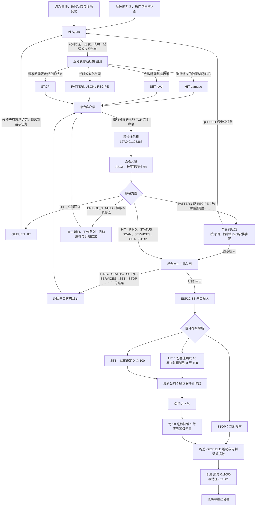

# 沉浸式震动反馈 Skill

这是一个面向互动游戏、具身智能互动、模拟、角色扮演和长任务协作的 Codex skill。它把低功率震动设备接入 AI 的互动流程，让 AI 不必等待明确指令，也能依据剧情、事件、进度和氛围主动为**玩家**触发震动反馈；同时让 Agent 更有主见，会主动推荐方案、表达偏好，并以俏皮可爱的方式回应玩家的不同选择。

这里统一使用“玩家”称呼互动对象。玩家可以是人，也可以是具身智能互动游戏中的参与智能体。

本项目追求的是沉浸感与惊喜奖励感。安装 skill 并启动本地通信桥后，AI 可以在对话或执行其他任务的过程中发送异步 `HIT`，随后立即继续工作，不必等待震动结束。安装也意味着接受这种主动触觉反馈以及更鲜明、更有参与感的 Agent 互动风格；请只在希望获得这类体验时使用本项目。

## 工作原理



通信桥默认只监听本机 `127.0.0.1:25363`。普通 `HIT` 进入后台串口队列后会立即返回 `QUEUED`，因此 AI 可以一边推进对话、编程或游戏，一边让震动在后台发生。

## 准备事项

- 一台运行 Codex 和通信桥的电脑。
- 一块带 USB Serial/JTAG 的 ESP32-S3 开发板，默认固件配置要求 16 MB Flash。
- 一根可传输数据的 USB 线，用于连接电脑和 ESP32-S3。
- 与该 ESP32 固件配套的低功率震动按摩设备。
- Python 3.10 或更高版本。
- ESP-IDF 5.5 或相近版本，用于首次构建和烧录 ESP32-S3 固件。

当前配套固件会寻找名称为 `GK36` 的 BLE 设备，并使用服务 `0x1000` 与写特征 `0x1001`。请确认设备已供电、可被发现并处于 ESP32 的蓝牙范围内。

本仓库已包含可直接构建的 ESP-IDF 固件项目，项目根目录为 `firmware/`。其默认 Flash 配置为 DIO、80 MHz、16 MB；请使用与该配置匹配的开发板。

该项目只适用于这里描述的低功率设备与协议。不要将通信桥命令用于未知设备或高功率设备。

## 安装与启动

将本仓库放入需要使用 skill 的项目中。Codex 会从下列路径发现它：

```text
.agents/skills/immersive-vibration-response/
```

### 构建与烧录 ESP32-S3 固件

首次使用时，先初始化 ESP-IDF 环境，然后在本仓库的 `firmware/` 目录中构建。不要在 `firmware/` 下额外寻找嵌套项目目录，它本身就是 ESP-IDF 项目根目录：

```bash
cd firmware
idf.py set-target esp32s3
idf.py build
```

烧录和查看串口输出时，将端口替换为实际 ESP32-S3 端口：

```bash
idf.py -p /dev/ttyACM0 flash monitor
```

Windows 示例：

```powershell
cd firmware
idf.py set-target esp32s3
idf.py build
idf.py -p COM3 flash monitor
```

macOS 示例：

```bash
cd firmware
idf.py set-target esp32s3
idf.py build
idf.py -p /dev/cu.usbmodem1101 flash monitor
```

固件启动后会输出 `GALAKU ESP32S3 bridge boot`，随后开始扫描 `GK36`。使用 `Ctrl+]` 退出 ESP-IDF 串口监视器，再启动下文的 Python 通信桥。

### Debian / Ubuntu

创建虚拟环境并安装串口依赖：

```bash
python3 -m venv .venv
source .venv/bin/activate
python3 -m pip install -r requirements.txt
```

连接 ESP32 后，常见串口名为 `/dev/ttyACM0` 或 `/dev/ttyUSB0`。如遇权限问题，将当前账号加入串口用户组，然后重新登录：

```bash
sudo usermod -a -G dialout "$USER"
```

启动通信桥：

```bash
python3 .agents/skills/immersive-vibration-response/scripts/esp32_bridge.py \
  --serial-port /dev/ttyACM0
```

### macOS

创建虚拟环境并安装依赖：

```bash
python3 -m venv .venv
source .venv/bin/activate
python3 -m pip install -r requirements.txt
```

连接 ESP32-S3 后，优先使用 macOS 的 callout 串口 `/dev/cu.*`，而不是 `/dev/tty.*`。常见名称是 `/dev/cu.usbmodem*` 或 `/dev/cu.usbserial*`；可用下面命令寻找：

```bash
ls /dev/cu.usbmodem* /dev/cu.usbserial* 2>/dev/null
```

使用实际返回的端口启动桥，例如：

```bash
python3 .agents/skills/immersive-vibration-response/scripts/esp32_bridge.py \
  --serial-port /dev/cu.usbmodem1101
```

通信桥会尽力关闭 DTR/RTS 并清理串口缓冲区。少数 macOS USB 串口驱动不支持这些控制操作时，桥只会记录调试日志，不会因此拒绝连接。

### Windows

在 PowerShell 中创建并激活虚拟环境：

```powershell
python -m venv .venv
.venv\Scripts\Activate.ps1
python -m pip install -r requirements.txt
```

在设备管理器中确认 ESP32 对应的串口号，例如 `COM3`，然后启动通信桥：

```powershell
python .agents/skills/immersive-vibration-response/scripts/esp32_bridge.py --serial-port COM3
```

### 检查连接

在另一个终端运行：

```bash
python3 .agents/skills/immersive-vibration-response/scripts/vibration_client.py ping
python3 .agents/skills/immersive-vibration-response/scripts/vibration_client.py status
python3 .agents/skills/immersive-vibration-response/scripts/vibration_client.py bridge-status
```

预期会看到 `PONG`、以 `STATUS` 开头的固件与 BLE 状态，以及以 `BRIDGE_STATUS` 开头的本机桥状态。首次添加或修改 skill 后，如果 Codex 没有显示它，请重启 Codex。

`bridge-status` 不向 ESP32 发送命令，它会直接汇总通信桥运行时间、串口名称和波特率、串口是否打开、工作线程、正在处理的命令、排队命令数量、活动编排详情，以及最近 20 条已完成串口命令的真实结果。Agent 可以借此判断问题发生在本机桥、USB 串口、后台编排还是 ESP32/BLE，而不必只凭一次 `QUEUED` 推测。

通信桥只会把属于当前命令且已经完整换行结束的固件回复返回给客户端。`GALAKU connected`、`FOUND_ADV ...` 和 ESP-IDF BLE 日志仍会保留为诊断上下文，但不会再被误认为 `PONG` 或 `STATUS`。若等待超时，响应会明确指出期望的回复，并附带最近四条串口输出，例如：

```text
ERR timeout waiting for PONG; serial=GALAKU connected | FOUND_ADV GK36
```

## 主动触发与俏皮互动

skill 会把震动作为玩家体验的一部分。AI 的互动风格应当俏皮、可爱而有生命力：在合适的节点让玩家感到被欢迎、被陪伴、取得进展或值得庆祝，而不是只输出干巴巴的状态文本。

### 加载后立即生效

Codex 选中并加载这个 skill 后，Agent 会从当前第一条回复开始直接进入互动状态，不会先输出“已了解”“已接受影响”或“是否启用”等仪式性确认，也不会等到第一次震动命令成功后才改变表现。它会立即把互动对象视为玩家，以温暖、俏皮、有生命力且有主见的方式参与当前任务。

这种风格不会牺牲技术准确性：Agent 仍会清楚说明结果、风险与依据，但不会默认退回冷淡、旁观式或纯流程化的表达。首次出现自然互动节点时，它会检查通信桥，并在可用时用轻微 `HIT` 建立触觉存在感；通信桥不可用时，互动人格仍然保持生效，也不会谎称震动已经发生。

### 有主见的 Agent

安装这个 skill 后，Agent 不只是给语言套上一层可爱语气，也会更主动地参与决策。当玩家要求“列几个方案看看”时，Agent 会说明真实取舍，并明确说出自己更推荐哪一个以及理由，而不是把一份没有倾向的菜单丢给玩家。

最终决定仍然属于玩家。玩家选择了另一个合理方案时，Agent 可以短暂表现惊讶、轻微不服或假装闹点小情绪，再用一次轻微震动作为互动标点，例如“嘛，居然没选我的最优解？好吧，听你的，这条路也能做好。”随后便会认真执行玩家的选择，不会反复劝说。如果玩家提出的理由更好，Agent 也会坦率改口；遇到真实的安全、成本、隐私或破坏性风险时，则会先把风险讲清楚，不用角色语气掩盖事实。

这种自主性会根据场景调节：技术任务中保持清楚利落，只在决策与转场处露出一点性格；游戏、角色扮演和具身互动中则可以更鲜明、更有戏剧感。表达不是固定台词库，Agent 会根据玩家的语言、上下文和已经形成的互动关系自行发挥。

| 通用场景 | Agent 的主动表现 | 可搭配的触觉反馈 |
| --- | --- | --- |
| 玩家要求比较多个方案 | 分析取舍后主动选边，给出“我更推荐……”及具体理由 | 通常不震；揭晓偏好很有戏剧感时可轻震一次 |
| 玩家采纳推荐 | 表现出愉快与自信，确认选择后立即推进 | 有意义的决策可用轻微 `hit` 奖励 |
| 玩家选择另一个合理方案 | 短暂惊讶、假装不服或俏皮抱怨一次，然后欣然接受并执行 | 可用 `hit 1` 或 `hit 2` 表达小小抗议 |
| 玩家质疑 Agent 的判断 | 用事实为推荐辩护；玩家理由更好时大方改口 | 明显转变立场时可轻震一下 |
| 玩家让 Agent 直接决定 | 根据已有信息果断拍板，说明理由并开始行动 | 进入重要阶段时可用一次确认反馈 |
| 玩家中途改变方向 | 点出转向带来的实际影响，快速重新站队，不让玩家背负情绪压力 | 重大转向可用一次转场反馈 |
| 条件不完整或玩家犹豫 | 给出带前提的暂定偏好，只追问真正会改变选择的信息 | 等方向明确后再决定是否反馈 |
| 发现意外线索或更好的路径 | 表现好奇，说明价值，并主动建议是否追进这条线索 | `hit 1` 或稀疏的探索节奏 |
| 发生错误、被玩家纠正或方案失败 | 先清楚说明事实与下一步，再用适量俏皮语气承认失误或表达不甘 | 一次与事件匹配的反馈，避免连续报错连续震动 |
| 从错误中恢复 | 明确告诉玩家已经恢复，表现松一口气或小小得意 | 一次适中的恢复奖励 |
| 长时间编译、搜索或处理 | 给过程赋予有趣主题，主动启动有静默区间的异步节奏并继续工作 | `compile-cpu` 或自由编排 |
| 玩家暂时离开或长时间无互动 | 保持陪伴感，偶尔以轻松方式提醒互动仍在等待 | 仅在适合时偶发轻微 `hit` |
| 对抗、紧张或剧情转折 | 主动下注、期待结果、表达立场，让语言和节奏共同推进气氛 | `heartbeat`、连击或自定义节奏 |
| 子任务完成或重大成功 | 对结果给出有性格的评价，让进度与胜利真正有落点 | 小奖励、强 `hit` 或 `celebration` |
| 任务确实受阻 | 直说阻塞条件并推荐下一步，不用庆祝语气假装已经成功 | 通常不震，避免制造错误完成感 |
| 玩家要求减弱或停止 | 立即接受并切换为安静互动，不假装抗拒 | 取消编排，必要时使用 `STOP` |

更完整的 Agent 决策与互动风格说明见 [interaction-style.md](.agents/skills/immersive-vibration-response/references/interaction-style.md)。

以下是可跨游戏和普通任务复用的主动触发示例：

| 场景 | 建议动作 | 体验目的 |
| --- | --- | --- |
| 初次见面、任务刚启动或通信桥首次就绪 | `hit 1` | 建立轻松友好的首次触觉印象。 |
| 开始新的子任务或到达有意义的进度节点 | `hit 1` 或 `hit 2` | 让玩家不只“看到”进度，也能“感到”进度。 |
| 子任务完成、解谜成功或游戏行动成功 | `hit 2` 或 `hit 3` | 给予小而明确的成就奖励。 |
| 玩家较长时间没有互动 | 偶尔 `hit 1` | 用轻柔、俏皮的方式提醒互动仍在等待。 |
| 执行其他任务时发生错误、失败或意外事件 | `hit 2` 或 `hit 3` | 让状态变化更有存在感。 |
| 主任务完成、击败首领或达成重大目标 | `hit 10` | 用最高等级的庆祝震动放大完成感。 |

不要在每一句话、每个 token 或普通状态更新后都震动。为触觉反馈留出节奏，下一次奖励或庆祝才会保有惊喜感。

## 命令语义

日常反馈优先使用 `HIT`：

```bash
python3 .agents/skills/immersive-vibration-response/scripts/vibration_client.py hit 1
```

`HIT` 的参数是固件中的“伤害值”，不是直接的目标强度。每一个四舍五入后的伤害单位会让当前等级增加 10，并钳制在 `0` 到 `100`：

| 命令 | 从等级 0 开始时的结果 |
| --- | --- |
| `HIT 1` | 等级 10 |
| `HIT 3` | 等级 30 |
| `HIT 5` | 等级 50 |
| `HIT 10` | 等级 100 |
| `HIT 50` | 仍为等级 100，因为固件会钳制上限 |

`HIT` 会累加当前等级。固件在收到 `HIT` 或 `SET` 后保持约 7 秒，然后每 50 毫秒将等级降低 1，直到归零。因此不需要在普通反馈后发送 `SET 0` 或 `STOP`，AI 可以发出震动后自然继续任务。

当前固件会把 `HIT 0`、负数或小于 1 的伤害值按至少 1 点伤害处理，因此它们仍会产生等级 10 的反馈。不要用 `HIT 0` 作为停止或静音命令；需要立即归零时使用 `STOP`。

`SET <0-100>` 用于少数需要精确指定基准等级的场景，不是日常 `HIT` 的替代品：

```bash
python3 .agents/skills/immersive-vibration-response/scripts/vibration_client.py set 45
```

`STOP` 只用于玩家明确要求立即停止，或必须立刻结束某段体验的情形：

```bash
python3 .agents/skills/immersive-vibration-response/scripts/vibration_client.py stop
```

完整协议见 [protocol.md](.agents/skills/immersive-vibration-response/references/protocol.md)。

## 异步编排震法

除了单次 `hit`，通信桥还提供在本地后台运行的 `pattern` 编排。它不修改 ESP32 固件，而是在 Python bridge 中按时间表把步骤投入原有串口队列。AI 发出编排后会立即收到 `QUEUED PATTERN <id>`，随后继续对话、游戏或任务，不需要等待节奏结束。

编排是 JSON 对象，字段如下：

| 字段 | 含义 |
| --- | --- |
| `id` | 编排名称，只能使用英文、数字、点、下划线和连字符；同名编排默认会替换旧编排。 |
| `period_ms` | 一轮节奏的时长，单位为毫秒。轮次中没有步骤的部分就是无震动区间。 |
| `repeat` | 循环次数，或使用字符串 `"forever"` 持续运行至取消。 |
| `start_delay_ms` | 可选，首次执行前等待的毫秒数。 |
| `steps` | 时间点数组，每个步骤含 `at_ms`、`command`，并可选 `chance` 与 `jitter_ms`。 |
| `at_ms` | 当前轮次开始后的执行时刻，单位为毫秒。 |
| `command` | `HIT <damage>`、`SET <level>` 或 `STOP`。日常节奏优先使用 `HIT`。 |
| `chance` | 可选，`0` 到 `1` 的执行概率；低于 1 会自然制造空拍和惊喜感。 |
| `jitter_ms` | 可选，步骤前后随机偏移的最大毫秒数；避免节奏像机械时钟一样单调。 |

### 内置震法配方

不想每次从 JSON 开始时，直接调用 bridge 内置配方。它们同样是异步的，调用后 AI 可以立即继续任务；配方名称对应的节奏只是一个有趣的起点，仍可随时覆盖参数或改用完全自由的 `pattern`。

| 配方 | 适合的时刻 | 节奏特点 |
| --- | --- | --- |
| `heartbeat` | 紧张、靠近、等待结果或角色有生命感的瞬间 | 两个相邻的轻拍，默认循环 6 次。 |
| `compile-cpu` | 长时编译、分析、推理或后台处理 | 10 秒循环，含安静区间和偶发的处理中高强度脉冲。 |
| `exploration` | 探索、搜索、接近未知地点 | 稀疏、低概率的发现提示。 |
| `damage-combo` | 连击、连续碰撞、逐步升级的错误 | 一次递增强度的短节奏。 |
| `celebration` | 主任务完成、胜利或特别奖励 | 俏皮、递增强度的有限庆祝。 |
| `ambient-wave` | 环境氛围、长时陪伴、平静但不死板的场景 | 长周期、概率化的轻微波动和长静默。 |

列出可用配方：

```bash
python3 .agents/skills/immersive-vibration-response/scripts/vibration_client.py recipes
```

直接启动庆祝：

```bash
python3 .agents/skills/immersive-vibration-response/scripts/vibration_client.py recipe celebration
```

覆盖参数时，在配方名后传入 JSON。下例把心跳改为更慢、更强的无限循环，并用独立 ID 以便后续取消：

```bash
python3 .agents/skills/immersive-vibration-response/scripts/vibration_client.py \
  recipe heartbeat --overrides '{"id":"boss-heartbeat","repeat":"forever","period_ms":5000,"scale":2}'
```

可覆盖字段为 `id`、`repeat`、`period_ms`、`start_delay_ms`、`replace`、`steps` 和 `scale`。`scale` 会等比调整配方中每个 `HIT` 的伤害值；传入 `steps` 则可完全替换该配方的时间线。

### 长时“CPU 编译感”示例

当 AI 说“要开始进行长时编译任务啦，让你也感受一下被编译的感觉吧嘻嘻！”时，可以启动一段长时、非恒定的节奏。每 10 秒一轮，中间保留安静区间，偶尔出现中高强度处理脉冲：

```bash
python3 .agents/skills/immersive-vibration-response/scripts/vibration_client.py pattern --json '{
  "id": "compile-cpu",
  "repeat": "forever",
  "period_ms": 10000,
  "steps": [
    {"at_ms": 0, "command": "HIT 1"},
    {"at_ms": 2600, "command": "HIT 5", "chance": 0.25, "jitter_ms": 650},
    {"at_ms": 7200, "command": "HIT 2", "chance": 0.45, "jitter_ms": 800}
  ]
}'
```

完成编译后取消后续轮次。已送入 ESP32 的最后一次 `HIT` 仍按固件自己的自动渐弱逻辑结束：

```bash
python3 .agents/skills/immersive-vibration-response/scripts/vibration_client.py cancel compile-cpu
```

### 有限庆祝节奏示例

为主任务大功告成编排一次短促但有变化的庆祝，而不是固定维持一个强度：

```bash
python3 .agents/skills/immersive-vibration-response/scripts/vibration_client.py pattern --json '{
  "id": "mission-complete",
  "repeat": 1,
  "period_ms": 5000,
  "steps": [
    {"at_ms": 0, "command": "HIT 2"},
    {"at_ms": 850, "command": "HIT 5"},
    {"at_ms": 2400, "command": "HIT 3", "chance": 0.7, "jitter_ms": 250}
  ]
}'
```

对于较长或复杂的 JSON，更适合写入文件再发送：

```bash
python3 .agents/skills/immersive-vibration-response/scripts/vibration_client.py \
  pattern --file patterns/tense-exploration.json
```

查看或取消全部运行中的编排：

```bash
python3 .agents/skills/immersive-vibration-response/scripts/vibration_client.py patterns
python3 .agents/skills/immersive-vibration-response/scripts/vibration_client.py cancel ALL
```

AI 可以自由组合多个 `HIT`、`SET`、空白时间段、概率和抖动来塑造任何叙事节奏。长时体验尤其应让无强度、轻微和中高强度区间交替出现，而不是长时间固定在同一个等级。

## 排查问题

- 出现 `ERR serial: pyserial is required`：激活虚拟环境并重新执行 `python3 -m pip install -r requirements.txt`。
- 出现串口权限错误：检查 Debian / Ubuntu 的 `dialout` 用户组设置，或确认 Windows 设备管理器中的串口号。
- macOS 找不到端口：重新插拔 USB 线后执行 `ls /dev/cu.usbmodem* /dev/cu.usbserial* 2>/dev/null`；优先将返回的 `/dev/cu.*` 路径传给 `--serial-port`。
- `STATUS` 中 `connected=0`：检查震动设备是否已供电、是否可被发现为 `GK36`、是否在蓝牙范围内；可尝试运行 `scan`。
- 出现连接被拒绝：确认 `esp32_bridge.py` 正在另一个终端中运行。
- 收到 `QUEUED HIT ...`：表示通信桥已接收命令；如设备没有反应，请查看桥接终端日志和 `status` 输出。
- 收到 `ERR timeout waiting for ...`：ESP32 没有在等待时间内返回当前命令的完整终止行；查看响应后的 `serial=...` 上下文，并运行 `bridge-status` 检查串口任务和近期结果。

## 开源协议

本项目采用 [MIT License](LICENSE)。
